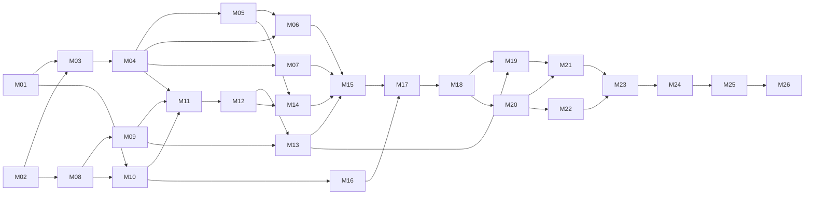

# Backlog do monk

Uma issue por arquivo (`M01.md` … `M26.md`). O frontmatter define responsável, labels e dependências; `{{Mxx}}` no texto vira o número real da issue.

## Criar as issues no GitHub

```bash
gh auth login                                  # conta com escrita no samuka7abr/monk
python3 scripts/criar_issues.py --dry-run      # prévia em backlog/_preview/
python3 scripts/criar_issues.py                # cria labels, issues e dependências
```

Para o GitHub aceitar a atribuição, `andreiabtiveron` e `ArturMSS` precisam ser colaboradores do repositório (Settings → Collaborators). O script é idempotente: pode rodar de novo depois de adicioná-los.

## Issues

| ID | Título | Responsável | Complexidade | Depende de |
|---|---|---|---|---|
| M01 | Criar o projeto Cargo, a estrutura de módulos e o CLI que ecoa o arquivo | @samuka7abr | baixa | — |
| M02 | Escrever a especificação da MiniLang, o rascunho da gramática e os programas de exemplo | @andreiabtiveron | baixa | — |
| M03 | Definir os tipos de token (token.rs) | @andreiabtiveron | baixa | M01, M02 |
| M04 | Implementar o analisador léxico manual (lexer.rs) | @samuka7abr | media | M03 |
| M05 | Adicionar a opção --tokens ao CLI | @andreiabtiveron | baixa | M04 |
| M06 | Reportar erros léxicos com recuperação em modo pânico (tag v0.1-lexer) | @samuka7abr | media | M04, M05 |
| M07 | Analisar o scanner de um projeto didático real (docs/analise-lexer.md) | @andreiabtiveron | baixa | M04 |
| M08 | Finalizar a gramática EBNF sem ambiguidade e com a tabela FIRST | @andreiabtiveron | media | M02 |
| M09 | Montar o banco de casos de teste válidos e inválidos | @samuka7abr | baixa | M08 |
| M10 | Definir os nós da AST (ast.rs) | @samuka7abr | media | M01, M08 |
| M11 | Parser recursivo descendente — utilitários e expressões | @ArturMSS | alta | M04, M09, M10 |
| M12 | Parser recursivo descendente — comandos, blocos e programa | @ArturMSS | alta | M11 |
| M13 | Teste automático do banco de casos sintáticos (tests/casos.rs) | @andreiabtiveron | baixa | M09, M12 |
| M14 | Pretty-printer da AST e opção --ast | @andreiabtiveron | media | M05, M12 |
| M15 | Checkpoint do frontend sintático — integração, README e tag v0.2-checkpoint | @samuka7abr | media | M06, M07, M13, M14 |
| M16 | Implementar a tabela de símbolos com escopos aninhados (simbolos.rs) | @andreiabtiveron | baixa | M10 |
| M17 | Analisador semântico inicial — escopos, redeclaração e uso não declarado | @samuka7abr | media | M15, M16 |
| M18 | Verificação de tipos, anotação da AST e supressão de erros em cascata | @ArturMSS | alta | M17 |
| M19 | Banco de casos semânticos e mensagens no CLI (tag v0.3-semantica) | @andreiabtiveron | baixa | M13, M18 |
| M20 | Gerar código de três endereços (TAC) a partir da AST (ir.rs) | @ArturMSS | alta | M18 |
| M21 | Opção --tac e testes de integração do TAC | @samuka7abr | media | M19, M20 |
| M22 | Máquina virtual que executa o TAC (vm.rs) | @ArturMSS | alta | M20 |
| M23 | Pipeline completo no CLI, --stats e testes ponta a ponta (tag v0.4-vm) | @samuka7abr | media | M21, M22 |
| M24 | Otimizador — contrato de passes, dobramento e propagação de constantes, ponto fixo e -O | @ArturMSS | alta | M23 |
| M25 | Otimizador — saltos constantes, código morto e limpeza de rótulos | @samuka7abr | media | M24 |
| M26 | Teste de equivalência, tabela comparativa antes/depois e entrega final (tag v0.5-otimizacao) | @andreiabtiveron | media | M25 |

## Grafo de dependências


